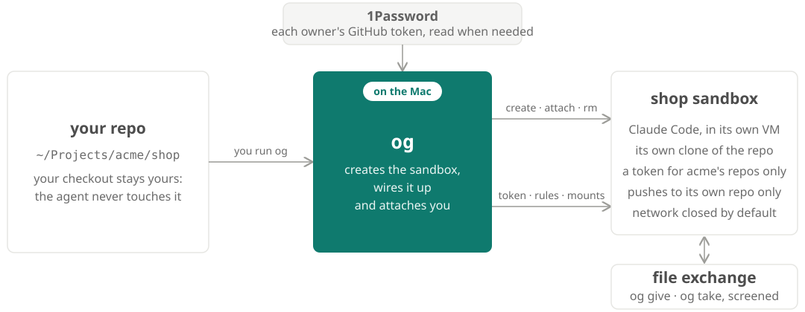
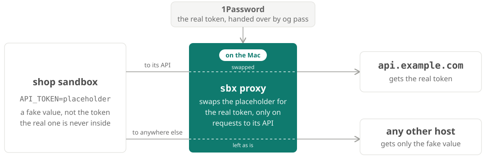

<div align="center">

<h1> ogun</h1>

**Claude Code in a sandbox per repo. Never on your Mac.**

[](https://github.com/yoaquim/ogun/actions/workflows/test.yml)

[Quick start](#quick-start) · [Install](#install) · [Docs](docs/README.md) · [MIT license](LICENSE)

</div>

<br>

[Docker Sandboxes](https://docs.docker.com/ai/sandboxes/) gives each agent its own VM.
`og` (or `ogun`) makes that one command per repo, and decides what each sandbox gets: its
code, its token, its network, its files.



## Quick start

```bash
git clone https://github.com/yoaquim/ogun.git && cd ogun && ./setup.sh

cd ~/Projects/acme/shop     # any repo under ~/Projects/<owner>/
og token acme               # once per owner: a GitHub token, saved in 1Password
og                          # creates shop's sandbox and attaches you
og rm shop                  # done for good
```

## One sandbox per repo

Run `og` in a repo to create its sandbox; run it again to attach. Exiting Claude only
detaches. The sandbox works on its own clone, so the agent's edits never reach your checkout,
and `og rm` refuses while unpushed or uncommitted work would be lost.

| Command | |
|---|---|
| `og` · `og attach shop` | into Claude |
| `og sh shop` | a shell inside |
| `og ls` | every sandbox and its status |
| `og stop shop` · `og rm shop` | stop it, or remove it |

## Network

Closed by default. When the agent needs more, it asks, and you approve it for that sandbox
alone, read-only first.

| | Hosts | Why |
|---|---|---|
| **Open** | OS mirrors, GitHub's download hosts | nobody hostile can write there |
| **Read-only** | npm, PyPI, Docker Hub, github.com | installs and clones work; uploads don't |
| **Blocked** | everything else, AWS included | until you approve it |

## GitHub

Each owner's token lives in 1Password; `og token` makes and rotates it, and og warns before
it expires. Every sandbox can clone and pull, but pushes go only to its own repo and the ones
you list, so a tricked agent can't push private code into one of your public repos.

## Secrets

Secrets stay on the Mac. A sandbox holds a placeholder, and the proxy swaps in the real value
only on requests to the host it's for. `og pass` hands one sandbox one secret this way.



## Files

One folder on the Mac, `~/sandboxes.noindex`, is the only way files move between the Mac and
sandboxes. `og give` puts files in; `og take` brings results out after a check, quarantining
links, executables and files that aren't what their name says.

| Folder | Inside a sandbox | For |
|---|---|---|
| `inbox/` | read-only, every sandbox | files for all of them |
| `boxes/<name>/in/` | read-only, that sandbox | files for one |
| `boxes/<name>/out/` | read-write, that sandbox | its results, for you |
| `shared/` | read-only; its own folder writable | notes between sandboxes |

## Templates, MCP and plugins

Templates are images built from recipes you keep in git, so a sandbox starts with its tools
installed. A recipe's header names the hosts it needs beyond the baseline, for its build and
for the sandboxes made from it.

```bash
# runtime-egress: api.orders.example
# scrub: ~/.psql_history
command -v psql >/dev/null || sudo apt-get install -y postgresql-client
```

MCP servers load per repo through sbx's gateway, with their tokens kept on the Mac. Claude
plugins mount from your marketplaces.

## OpenAPPA

An optional guard inside the session, for repos that hold something sensitive. With `--appa`,
[OpenAPPA](docs/appa.md) checks each write against what the session has read, so private data
can't land somewhere public in a way the network can't tell from normal work.

## Make it yours

og sets up only what it needs. Mount folders, run your own setup script in every sandbox, add
apt tools: og runs what you name without knowing what's in it. Settings, repos and templates
live in `~/.config/ogun/` ([customizing](docs/config.md#make-sandboxes-your-own)).

## Install

Requires macOS, Docker Sandboxes (`sbx`), 1Password and its CLI (`op`), `git` and `curl`.
`./setup.sh` builds og from pinned, checksummed versions and puts `og` on your PATH; it runs
with no configuration ([setup](docs/setup.md)).

## Docs

[Overview](docs/README.md) · [Setup](docs/setup.md) · [Sandboxes](docs/sandboxes.md) ·
[Network](docs/network.md) · [Secrets](docs/secrets.md) · [Templates](docs/templates.md) ·
[File exchange](docs/exchange.md) · [OpenAPPA](docs/appa.md) · [Config](docs/config.md) ·
[Testing](docs/testing.md)
