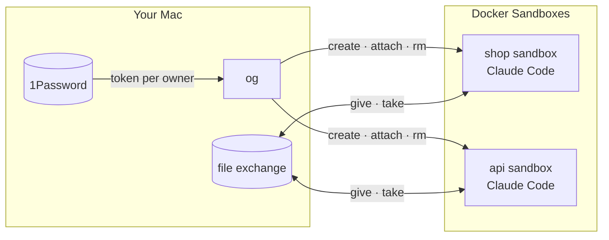

<p align="center">
  
</p>

<h1 align="center">Ogun</h1>

<p align="center">
  <b>Claude Code in a sandbox, one per project. Never on your Mac.</b><br>
  One command creates it, wires it up and drops you in.
</p>

---

```bash
cd ~/Projects/acme/shop     # any repo
og                          # creates the sandbox and attaches you; next time, just attaches
og rm shop                  # done for good (refuses if work would be lost)
```

## What you get



| | |
|---|---|
| 🔒 **Isolated** | Each repo gets its own sandbox; the agent never runs on the Mac. |
| 🔑 **Scoped tokens** | A GitHub token per owner, from 1Password, injected by the proxy, never stored inside. |
| 🌐 **Default-deny network** | A small read-mostly baseline; pushes only to the repo's own remotes; anything else asks you first. |
| 📦 **File exchange** | Hand files in and take results out, screened on the way. |
| 🧩 **Yours to shape** | Mount folders, run your own setup, add tools, bake templates. |

## Install

Needs macOS, [Docker Sandboxes](https://docs.docker.com/ai/sandboxes/) (`sbx`), 1Password
and its CLI (`op`), `git` and `curl`.

```bash
git clone <this repo> ogun && cd ogun
./setup.sh      # og's pinned Python and packages; puts og on your PATH
```

It runs with no configuration. Your settings, repos and templates go in `~/.config/ogun/`
when you want them: [config](docs/config.md) ·
[make sandboxes your own](docs/config.md#make-sandboxes-your-own).

## Docs

[**Start here**](docs/README.md) · [Setup](docs/setup.md) · [Sandboxes](docs/sandboxes.md) ·
[Network](docs/network.md) · [Secrets](docs/secrets.md) · [Templates](docs/templates.md) ·
[File exchange](docs/exchange.md)

## License

[MIT](LICENSE)
