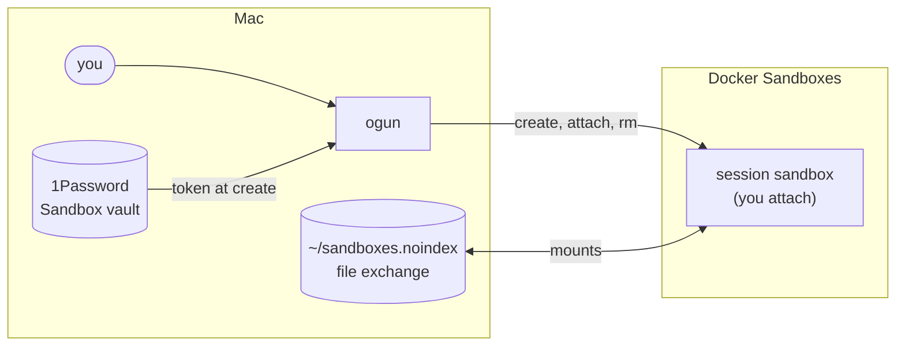

#  Ogun

`ogun` (alias `og`) runs Claude Code in Docker Sandboxes, one per project, and never on the
Mac itself. One command covers the whole lifecycle: it creates the sandbox, wires in the
GitHub token, mounts, file exchange and MCP servers, and attaches you.

The code is Python, in `src/ogun/`. Every call runs the code on disk, so a change to it needs
no reinstall. Its settings live in `~/.config/ogun/config.toml`
([Appendix: environment](appendix/flags-and-env.md#settings)); how it's built and pinned is in
[Appendix: ogun's Python](appendix/ogun-python.md).

## Install

Clone this repo anywhere and run its setup. What the Mac needs first and how to name its
token items: [Setting up og](setup.md).

```bash
./setup.sh      # og's Python and packages, from pins; puts og on PATH
./test.sh       # og's tests: its shell tests, pytest and ruff
```

- **The command.** `setup.sh` builds og's own environment (`.venv` on a Mac) from its
  pins and links `og` and `ogun` into `~/.local/bin` (`OGUN_BIN`; empty, no links), so og
  runs from any shell, script or cron job. A link already there is pointed at this og; a
  file that isn't a link is left alone, and said. Run it again after a bump.
- **Tab completion.** Source `completion.bash` from your shell profile; setup ends by
  saying so.
- **Your files.** og runs with nothing of yours: a registry, templates, settings and the rest
  go in its config folder ([og's config folder](config.md)).
- **Tests.** `test.sh [<filter>]` runs every file in `tests/sh/`, among them og's pytest
  suite and ruff; one that can't run (og's Python not built) is a skip, never a pass. Among
  them, `copy.test.sh` copies the repo to a folder with nothing beside it, runs setup and
  this runner there, and og's core commands with an empty config folder: anything in og that
  reaches outside its folder fails it.

`-v` before a command (or anywhere in its arguments) shows each `sbx` command Ogun runs and
how it ended; `-vv` adds what `sbx` printed. On a terminal the output is colored; piped
or in a file, it's the plain words. Every command follows one style
([Appendix: og's style](appendix/ogun-style.md)); `ogun style` draws it.

## Architecture



| Piece | What it is | Details |
|---|---|---|
| session sandbox | where you work. One per repo, named after the directory | [Sandboxes](sandboxes.md) |
| template | the image a new sandbox starts from, tools already installed | [Templates](templates.md) |
| file exchange | the one path files travel between the Mac and sandboxes | [Exchange](exchange.md) |
| OpenAPPA | an optional guardrail inside the session, against private data reaching your own public repos; installed with `--appa` | [OpenAPPA](appa.md) |

## Quick start

```bash
cd ~/Projects/personal/cub      # any repo under ~/Projects/<owner>/
ogun                            # first run creates and attaches; later runs attach
# … work in Claude; exiting only DETACHES …
ogun rm cub                     # done for good (refuses if work would be lost)
```

## Commands

`ogun help` prints this list, and `ogun <command> --help` prints one command's usage. Both
read the same table the code's own usage errors use, so they can't drift apart.

| Command | Does |
|---|---|
| `ogun [<name>]` | create or attach the sandbox for the current repo (or by name) |
| `ogun ls [--json]` | list sandboxes: name, agent, status, each state marked on a terminal (any other argument: raw `sbx ls`) |
| `ogun attach <name>` | attach Claude in a sandbox that exists |
| `ogun sh <name> [<command>…]` | a login shell inside, or one command run there (its exit code kept) |
| `ogun stop <name>…` \| `--all` | stop sandboxes without removing them; attaching starts them again |
| `ogun ports <name> [[<mac port>:]<port>… \| --rm <port>…]` | a sandbox's published ports: list, publish on this Mac's loopback, unpublish |
| `ogun doctor` | how this Mac's sbx and og stand: sbx's own checks, then og's; only reads, each fix printed |
| `ogun ssh <name>` | ssh in (once: `sbx setup ssh`); `<name>.sbx` also mounts over SFTP |
| `ogun rm <name> [--force \| --if-clean]` | remove a sandbox and its folder in the exchange; `--if-clean`: only when no unpushed work, uncommitted file, live Claude session or open terminal would be lost |
| `ogun allow <name> <domain>…` · `--all <domain>…` | allow egress to these domains for one sandbox (`--all`: every sandbox); `github.com/<owner>/<repo>`: a push to that repo ([Network](network.md#pushes-to-github)); `--read-only`: reading only |
| `ogun policy` | re-apply the safety settings for every sandbox: baseline egress, each sandbox's push rules and its registry egress, ssh-agent forwarding off, and the removal line for any allow that covers all of `github.com` (secret grants are applied per sandbox at create: [secrets](secrets.md#secret-grants)) |
| `ogun give [<name>] <file>…` · `--clip` | hand files (or the clipboard image) to every sandbox, or to one |
| `ogun ship <name> <patch> --remote <r> --branch <b> --base <sha> --commits <n> --tree <sha>` | from your clone: push a branch the sandbox couldn't (a workflow change). Applies its patch in a throwaway worktree with hooks off, refuses binaries and submodules, pages every commit, pushes on your `y` ([secrets](secrets.md)). The sandbox prints the whole line |
| `ogun take <name> [<file> \| --all]` | list a sandbox's `out/`, or check and move files to `~/Downloads` |
| `ogun scan` | sweep `shared/`: text only, quarantine violators, commit history; says each change, or that there was none |
| `ogun tidy [--rm]` | list (`--rm`: remove) folders whose sandbox is gone, and the secrets left for one |
| `ogun net <name>\|--all [--sbx \| <domain>\|github.com/<owner>/<repo>... [--read-only \| --deny \| --rm \| --check]]` · `ogun net <name>\|--all --log [-n <count>]` | a sandbox's network rules: bare, list them (`--sbx`: with the rules sbx sets itself); with domains or repos, allow (the default), block (`--deny`), remove (`--rm`) or ask whether they're allowed (`--check`); `--log`: what it tried to reach, newest first; `ogun allow` is its allowing alone |
| `ogun log [-n <count>] [--json]` | what og changed on this Mac, newest last: removals, allows, policy, the registry |
| `ogun pass <name> <ENV_VAR> <host>…\|--expose [--item <name>\|--paste] [--vault <v>] [--field <f>]` · `ogun pass <name> <ENV_VAR> --rm` · `ogun pass <name>` | hand one secret to one sandbox, from 1Password (an item, in a vault other than the default, a field other than `credential`) or pasted; `--rm` takes it back; a name alone lists what it holds ([Secrets](secrets.md#any-other-secret-og-pass)) |
| `ogun token [<owner>] [<days>]` | mint or rotate an owner's GitHub token: GitHub's form pre-filled, saved in 1Password, its expiry recorded ([Secrets](secrets.md#minting-and-rotating-og-token)) |
| `ogun skills` | mirror the skills folder (`SBX_SKILLS_DIR`) into sbx's shared skills store, which every sandbox mounts, and lock it read-only |
| `ogun project ls [--json]` · `ogun project add [<repo>] [--write]` | the repo registry: what mounts into this repo's sandboxes |
| `ogun mcp [ls [--json]]` · `ogun mcp auth <server> \| --all` · `ogun mcp load <name>` | gateway MCP servers: login status and who gets each; log in again (then reloaded into the running sandboxes that use it); reload one sandbox's servers ([MCP gateway](appendix/mcp-gateway.md#logging-in-again)) |
| `ogun template [<name> \| ls [--json] \| rm <name>]` | build sandbox templates, list them, or remove one's image |
| `ogun style` | draw every pattern og's output uses: steps, notes, warnings, errors, a callout, a summary, a usage box ([style](appendix/ogun-style.md)) |
| `ogun help [<command>]` | this list, or one command's usage |

Flags for a bare `ogun` or `ogun <name>`:

| Flag | Does |
|---|---|
| `--org <owner>` | token owner, overriding the one its folder names |
| `--item <vault item>` | the exact token item; its name gives the owner |
| `--name <name>` | sandbox name, overriding the directory's |
| `--sync` | re-run setup and the skills mirror, and read the GitHub token from 1Password again, before attaching |
| `--rm` | remove the sandbox when you exit Claude (same refusals as `ogun rm`) |
| `--appa` | protect a new sandbox's sessions with OpenAPPA ([OpenAPPA](appa.md)); a template can ask with `# appa: on` |
| `--no-attach` | create without attaching |

## Output

- **Tab completion** follows the command table without asking og or sbx: the commands are text, and sandbox names come from a file og rewrites each time it lists them (`~/.config/sbx/ogun/sandbox-names`); only `og mcp auth <TAB>` asks og, for the servers. Sandbox names where a name goes, then that
  command's subcommands and flags (`og net <name> <TAB>`, `og template <TAB>` for recipes). After a sandbox name it offers the create flags, with
  `--org` completing the owners `SBX_PROJECTS` names.
- **Read commands speak JSON:** `ogun ls --json`,
  `ogun project ls --json`, `ogun mcp ls --json`, `ogun template ls --json`.
- **On a terminal**, each message starts with a dim local clock and is colored by outcome:
  green done, yellow warning, red error. `NO_COLOR` or `TERM=dumb` turns that off. Pipes and
  files always get bare text, so grep and saved output never change.

## When to recreate

| Needs `ogun rm` + `ogun` | Live, no recreate |
|---|---|
| new related-repo grants (`ogun project add`) | edits in a read-only host mount (`SBX_HOST_RO_MOUNTS`): the mount is live |
| new host read-only mounts | skills, after `og skills` |
| a newly built template, or a newly cloned plugin | an `ogun pass` re-pass |
| the exchange tree, for a sandbox older than it | `ogun <name> --sync`: setup, the provision command, ssh keys, the agent probe |
| | new MCP servers for the repo, and renewed logins: every attach reloads them (`ogun mcp load <name>` without attaching) |

A **GitHub token rotation** isn't immediate either. See
[Secrets: minting and rotating](secrets.md#minting-and-rotating-og-token).

## Reference

- [og's config folder](config.md): your own files, apart from og's
- [Appendix: flags and environment](appendix/flags-and-env.md)
- [Appendix: ogun's Python](appendix/ogun-python.md)
