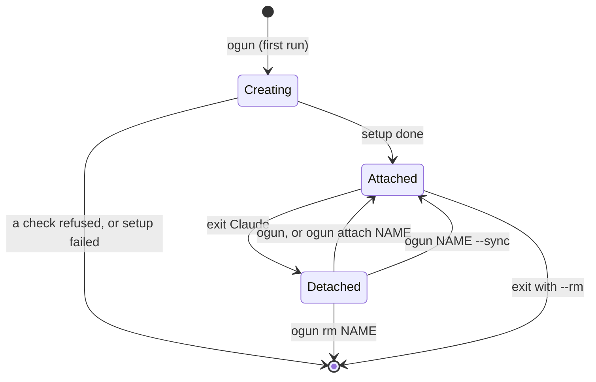

# Sandboxes

A **session sandbox** is where you work: one Docker Sandbox per repo, holding a private clone
of it. `ogun` creates it the first time and attaches you every time after that. Exiting
Claude only detaches. The clone, unpushed branches and the SSO session all stay until
`ogun rm`.

## Lifecycle



### Name and owner

- **Name.** The directory's name, with a leading dot or dash dropped (`~/.scratch` becomes
  `scratch`). `--name` overrides it. `inbox`, `shared` and `boxes` are reserved.
- **Owner.** The folder under `~/Projects` picks the GitHub token:
  `~/Projects/acme/shop` → `acme`. `--org` or `--item` override it. See
  [Secrets](secrets.md#github-tokens).
- **Outside `~/Projects`.** A registry entry can place a repo by exact `path`, for example
  `"~/work/site"` with an `owner`. That path then counts as the owner's folder, for the
  token and the repo's other grants. Only the exact path counts, the entry's key must be the
  path's basename, and a `path` inside `~/Projects` is ignored. Anywhere else, `ogun` shows a menu of the vault's tokens
  (terminals only). Without a terminal it uses the personal token, so scripts should pass
  `--org` or `--item`.

### A folder that isn't a repo

A sandbox clones its workspace, so the workspace must be a git repo: sbx would mount
anything else read-write. Run `ogun` in a folder that isn't one and, at a terminal, it asks
to make it one (`git init` and an empty first commit) before asking anything else. Your
files stay uncommitted, and the sandbox still reads them, read-only, at
`/run/sandbox/source`. A folder that holds more than one project, or credentials, is refused
instead, repo or not: your home or above, `~/Projects`, an owner's folder
(`~/Projects/personal`), the exchange, or anything in a hidden home folder or `~/Library`
unless its own repo is rooted there (`~/.scratch`). The root of the repo a folder is in is
checked the same way, so a repo at `~` makes nothing under it a workspace. Without a
terminal it only refuses. A repo
with no commit yet is offered the empty first commit; if that commit fails (no git identity,
signing, a hook), the `git init` it followed is undone.

### What a create does

| # | Step |
|---|---|
| 1 | **refuses** unless sbx is signed in to Docker (otherwise: run `sbx login`), ssh-agent forwarding is off and `~/.ssh/sandbox` holds nothing trusted |
| 2 | picks the [template](templates.md) and reserves the exchange box |
| 3 | writes `.sbxenv.yaml`: the repo as the read-write workspace, plus read-only mounts (below), and lists them |
| 4 | mirrors skills, then `sbx env create`, approving sbx's plan of that same file: what sbx printed shows only if the create fails (or with `-vv`) |
| 5 | records the decision (template, why, mounts) |
| 6 | probes the new sandbox for an ssh-agent, and removes it if one answers |
| 7 | loads the repo's MCP servers |
| 8 | applies the baseline egress; installs `jq socat` and any apt tools `apt_tools` names, updates Claude Code, runs the provision command (`provision`, yours), copies ssh keys, sets up [Docker inside the sandbox](#docker-inside-a-sandbox), puts og ship's script (`workflow-push-request.sh`) in `~/.local/bin` |
| 9 | with `--appa` or a template's `# appa: on` only: sets the GitHub token, installs the pinned [OpenAPPA](appa.md) and turns it on, or removes the sandbox if it can't |
| 10 | sets HTTPS remotes, allows GitHub pushes to this repo's own remotes only ([Network](network.md#pushes-to-github)) and the [repo's own egress](network.md#a-repos-own-egress) and (without OpenAPPA) the GitHub token; for a private GitHub repo without OpenAPPA, prints a `NO OPENAPPA` warning; then attaches |

Every attach also runs the provision command again, sets HTTPS remotes and the push rules again, brings the [repo's own egress](network.md#a-repos-own-egress) in line with the registry, restarts the Docker relay if a restart stopped it, writes og ship's script again, and sweeps the exchange. In a sandbox with
[OpenAPPA](appa.md), it then checks OpenAPPA is ready and starts `clappa` instead of `claude`. `--sync` re-runs
the skills mirror, the agent probe and the setup half of step 8 (tools, Claude Code, the
provision command, ssh keys, Docker).

### Docker inside a sandbox

A sandbox runs its own Docker, but its containers can't reach the internet the way the
sandbox's shell does. sbx's proxy only serves traffic sent to it by address, at an address
containers can't reach, and it re-signs HTTPS with its own certificate. Container traffic it
intercepts instead is reset for npm, PyPI and GitHub, the baseline's read-only rules.
og's `sandbox-scripts/sandbox-docker.sh` fixes that at setup and on every attach:

- a relay (`socat`) on the Docker bridge's gateway, port 3128, to sbx's proxy;
- Docker's proxy setting (`~/.docker/config.json`), so every container and build sends HTTPS
  through the relay. HTTPS only: plain HTTP between containers (`http://minio:9000`) stays
  direct;
- the proxy's certificate at `~/.docker/sbx-ca/ca.crt`, exported as `DOCKER_EXTRA_CA_DIR`.
  Docker can pass settings into containers but not files, so each project's build trusts it
  itself: pass the folder as a build context (`docker build --build-context
  extra-ca="$DOCKER_EXTRA_CA_DIR" …`) and, in the Dockerfile, copy `ca.crt` into the image's
  CA folder and update its trust store. A build run outside a sandbox gets no such folder,
  so make that step skip when it's empty.

Docker Hub is in the baseline read-only ([Network](network.md#sandboxes-default-deny-egress)): every sandbox pulls
images with no approval, and none can push one.

The export is its only line in `/etc/sandbox-persistent.sh`. Nothing there starts the relay:
that file runs before every command, and a start that hangs would hang them all. A sandbox
restart stops the relay until the next attach, which starts it again: `og attach <name>`.

### What's mounted

| Mount | Access |
|---|---|
| the repo | read-write (a clone; the host checkout is at `/run/sandbox/source`) |
| host folders `host_ro_mounts` names (none by default) | read-only, live, at their own paths ([make sandboxes yours](customize.md#files-and-repos)) |
| related repos from the registry | read-only |
| the file exchange | per path, see [Exchange](exchange.md) |
| `~/.ssh/sandbox`, when it exists | read-only |
| a plugin marketplace's clone, where it applies | read-only |

## Related repos: `ogun project`

Stand in the repo you're setting up, and name what it should see:

```bash
cd ~/Projects/personal/cub
ogun project add widgets              # cub's sandboxes mount widgets read-only
ogun project add widgets --write      # …and cub's token may push to it
ogun project add https://github.com/acme/widgets   # cub's sandboxes may push there, no checkout needed
ogun project add                      # pick from this owner's checkouts
ogun project ls                       # every entry and its grants
```

- `widgets`, `personal/widgets` and `~/Projects/personal/widgets` all name the same repo.
- Grants land in og's registry (`registry.json` in its [config folder](config.md)): edit it
  with care, since it decides what sandboxes get. They take effect at the **next create**; a GitHub address (`repos.push`) at the next
  attach ([Network](network.md#pushes-to-github)).
- Refused, with a reason: cross-owner grants, non-checkouts, symlinks escaping the owner
  tree, granting a repo to itself, and a name that collides with another owner's entry. A repo
  the registry hasn't seen gets an entry seeded.

The same registry also holds each repo's MCP servers, GitHub org override, template and
plugin marketplaces. Per-repo capabilities only apply when the entry declares an `owner` and
the path is the repo it describes. That way a same-named repo under another owner never
inherits them.

## Removing

```bash
ogun rm <name>            # refuses if anything would be lost
ogun rm <name> --force    # removes anyway
```

`ogun rm` refuses while the sandbox has unpushed commits, uncommitted work (in the checkout
or any worktree of it, the sandbox's own workspace searched wherever it was mounted from), or background Claude jobs still running. That
check ignores Claude Code's worktrees folder (each worktree is checked on its own), og's own
files and read-only mounts. Past it, sbx asks its own y/N, and refuses a sandbox that's
in use, such as an open ssh or attached session. `--force` skips all of it, sbx's y/N and
in-use check included. `--if-clean` removes only when nothing would be lost (no unpushed or uncommitted work,
no Claude session mid-turn or waiting on you, no open terminal), and otherwise keeps it and
says why. Removing deletes the create record, and its folder in the exchange unless `out/` still holds
files you haven't taken.

## SSH: no agent, keys on purpose

**No ssh-agent.** sbx forwards the Mac's ssh-agent by default, and the agent may hold
your signing key. `ogun` refuses to create a sandbox, or build a
template, while `ssh.agentForwardingEnabled` reads anything but `false`. It sets the value
itself, but the daemon only applies it on restart, which interrupts running sandboxes, so
that part is yours, once per Mac:

```bash
sbx settings set ssh.agentForwardingEnabled false && sbx daemon restart   # sbx ≥ 0.42.1
```

Until that restart, `ogun` probes every new sandbox for an agent and removes one that still
reaches it. `--sync` probes too, and stops the attach if an agent answers.

**Keys on purpose.** Put keys you want sandboxes to use in `~/.ssh/sandbox`, a real
directory. It's mounted read-only into every sandbox, and setup copies its keys to
`~/.ssh/sandbox-keys/` with a `github.com` SSH config that never uses an agent. Every sandbox
can read and copy them, so use deploy keys or a GitHub signing-only key, never a key `protected_keys` names.
`ogun` refuses the folder if it holds a trusted signing key or a symlink. HTTPS with the
sandbox's token stays the default; SSH is opt-in (`git@github.com:…` remotes), except in the
workspace repo: there `ogun` turns GitHub SSH remotes into HTTPS, with a rewrite rule that
holds even when a sandbox start puts your Mac's remotes back.

**Signed commits.** A key named `signing` turns on commit signing in every sandbox that
mounts the folder. Make it without a passphrase, since there's no agent to unlock it, and
register its `.pub` on GitHub as a *Signing* key:

```bash
mkdir -m 700 -p ~/.ssh/sandbox
ssh-keygen -t ed25519 -N '' -C 'sandbox signing' -f ~/.ssh/sandbox/signing
gh ssh-key add ~/.ssh/sandbox/signing.pub --type signing --title 'sandbox signing'
```

GitHub shows the commits as Verified only when the commit email is verified on that account.
Details: [Appendix: the secrets proxy](appendix/secrets-proxy.md#the-sshsandbox-folder).

The mount is **live**: a file you drop in later is readable in every running sandbox at
once, before any check. `ogun` re-checks it and refreshes the copies on `ogun <name> --sync`.

Probe details and refusal rules: [Appendix: the secrets proxy](appendix/secrets-proxy.md#the-ssh-agent-guard).
