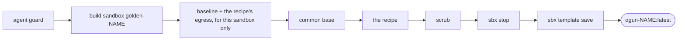

# Templates

A template is a Docker image on the Mac that new sandboxes start from, with the tools
already installed, so creates are fast. The image can't live in git, but its **recipe** does:
`templates/<name>.sh` in og's [config folder](config.md), built into `ogun-<name>:latest`.

Three example recipes, a fair picture of what one holds:

| Recipe | Adds to the common base | Picked by |
|---|---|---|
| `home` | nothing | a Mac whose og profile is `home` |
| `work` | a [Rust](https://www.rust-lang.org) toolchain (`rustup`, `cargo`, `rustc`) | a Mac whose og profile is `work` |
| `orders` | the PostgreSQL client, and the staging API it talks to (`api.orders.example`, at runtime only) | the `orders` repo's registry entry |

The common base is the same for every recipe: og's apt tools (`jq socat`) and any
`SBX_APT_TOOLS` names, and the latest Claude Code.

## Building

```bash
og template work      # build one recipe
og template             # build every recipe, one after another
og template ls          # recipes vs built images: image, built or not, created
og template ls --json   # the same, plus each recipe's egress
og template rm work   # remove a recipe's image; og template work builds it again
```

`og template ls` is a table; what isn't built is named at its foot with the command
that builds it.



If any step fails, nothing is saved and an older image stays as it was. The build sandbox is
removed either way. Rebuild when a recipe changes, and now and then so new sandboxes start
on a current Claude Code.

## Which template a create uses

`ogun` prints its choice and the reason:

1. the repo's registry entry names one (`"template": "work"`), under the same owner gate as
   its other grants;
2. otherwise the one named after this Mac's og profile (none without one);
3. otherwise none: sbx's default image.

A template that isn't built is passed over with the command that builds it, never a failed
create:

```text
template 'work' (this Mac's profile 'work') not built — run: og template work; using the sbx default
```


The create keeps its decision (the template, the image, why, and anything passed over) with
the mounts it wrote, in its record.

## What a recipe may do

A recipe is a bash script that runs inside the build sandbox. Every sandbox created from the
template shares whatever it leaves behind, so:

- no logins, no secrets, no per-repo setup. For `work`, that means a crate registry's login
  (`cargo login`) is yours to do inside each sandbox. The scrub removes any a build leaves;
- declare every domain the build downloads from (`# egress:`). They are allowed for the
  build sandbox only, and go with it when the build removes it;
- declare every domain a sandbox made from the template needs at runtime
  (`# runtime-egress:`). Each create allows them for that sandbox alone, records them,
  and `sbx rm` drops them with the sandbox. Other sandboxes never
  get them: the `crates.io` hosts open for work sandboxes, not home ones;
- say `# appa: on` to put the pinned [OpenAPPA](appa.md) in the image and in every sandbox
  made from it.

Header format and scrub rules: [Appendix: template recipes](appendix/template-recipes.md).
